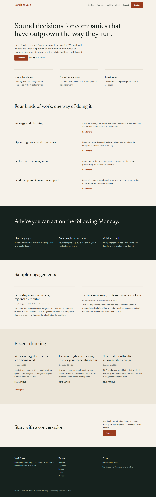
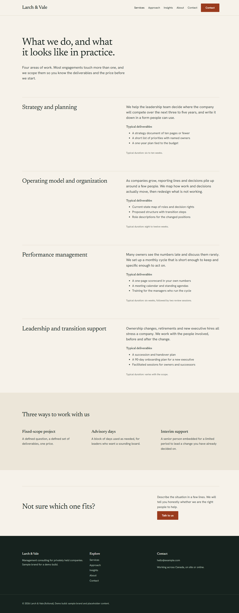

# Larch & Vale — Kadence demo site

A 6-page management consulting demo site built with WordPress, Gutenberg, Kadence Theme and Kadence Blocks (free versions only). The brand and all content are samples and placeholders.

## Open the live demo

[Open the live demo](https://playground.wordpress.net/?blueprint-url=https://raw.githubusercontent.com/ferhatkesen222-afk/kadence-consulting-demo/main/blueprint.json)

It takes about a minute to set itself up in your browser; nothing is installed on your computer.

## Pages

- Home
- Services
- Approach
- About
- Insights (with three sample articles)
- Contact

Open any page in the editor to see the Kadence blocks.

## Screenshots

## Fonts

Newsreader and Hanken Grotesk from Google Fonts, both under the SIL Open Font License (OFL).
